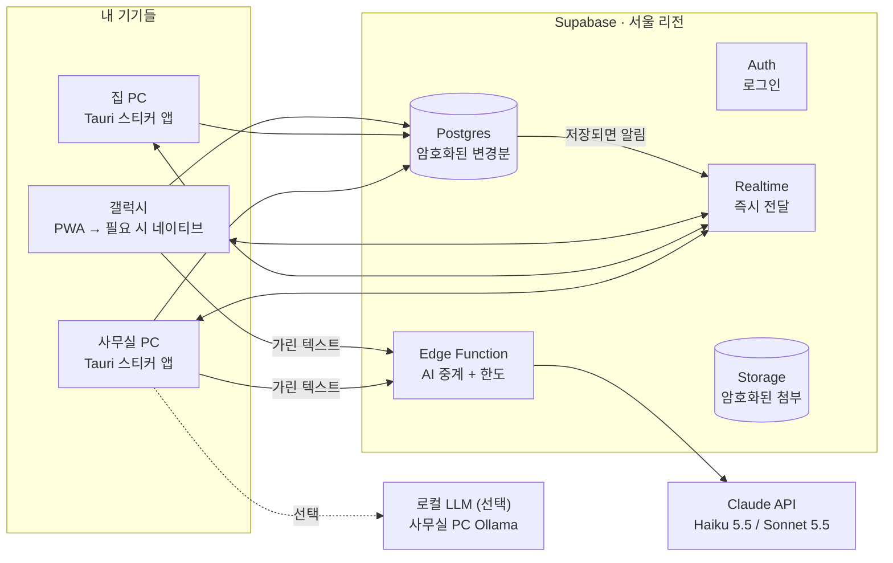
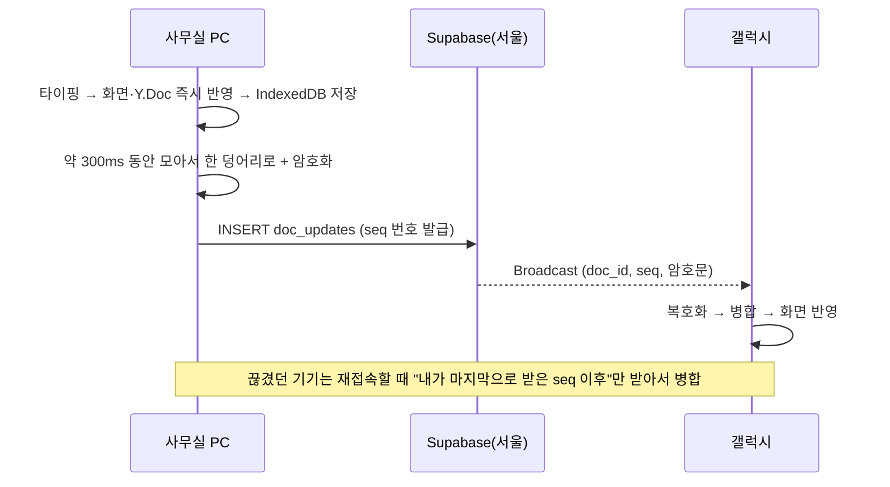

# BK-NOTE 설계 계획서

> 듀얼 모니터 오른쪽에 항상 붙어 있는 업무 스티커 노트. 갤럭시와 집·사무실 PC가 실시간으로 동기화되고, 서식을 쉽게 넣을 수 있고, AI가 정리를 도와준다.
>
> 작성일 2026-10-15 · 상태: 설계안 (구현 전)

---

## 0. 한 장 요약

| 항목 | 결정 |
|---|---|
| 형태 | **하이브리드**: 화면·편집기는 웹 기술로 한 번 만들고, PC에는 **진짜 윈도우 앱(Tauri)**, 폰에는 **설치형 웹앱(PWA)** 으로 시작해 필요하면 네이티브로 감싼다 |
| 편집기 | TipTap(ProseMirror): 굵게·기울임·밑줄·취소선·형광펜(여러 색)·글자색·체크박스. **OneNote 단축키를 그대로** 쓴다 |
| 동기화 | **Yjs(CRDT)**: 두 기기에서 동시에 고쳐도 글자 단위로 합쳐지고, 오프라인에서 쓴 것도 재접속하면 자동으로 합쳐진다 |
| 서버 | 필요함. 단, 직접 관리하는 서버가 아니라 **Supabase 서울 리전(무료 플랜)**. 계정에 무료 슬롯이 1개 남아 있다 |
| 지연 | 내 화면은 즉시 반영된다. 다른 기기에는 **보통 0.2~0.6초**, 모바일 데이터에서는 최악 1~2초 걸린다(추정치, 2단계에서 실측) |
| 보안 | 노트 내용은 **기기에서 암호화(E2EE)** 한 뒤 올린다. 서버에는 암호문만 남는다. 의뢰인 정보가 들어가니 기본으로 켠다 |
| AI | 무료 대안(로컬 LLM, Gemini 무료 티어)을 먼저 검토했다. 기밀 데이터를 생각하면 **Claude Haiku 5.5(유료, 월 몇천 원)** 가 기본값으로 낫다. 보내기 전에 전화번호·주민번호 등은 자동으로 가린다 |
| 비용 | 서버·배포는 **0원**. AI를 쓰면 **월 $1~3 수준**이다 |

---

## 1. 목표와 사용 장면

**지금 쓰는 방식**: OneNote 페이지 하나를 오른쪽 모니터에 띄워 두고 오늘 할 일, 대기 사안, 업무 메모, 아이디어를 섞어서 붙여 둔다.

**목표**
1. 켜면 늘 그 자리(오른쪽 모니터 오른쪽 끝)에 있고, 다른 창에 가려지지 않는다.
2. 사무실 PC에서 적은 게 집 PC와 갤럭시에 바로 보인다. 반대 방향도 마찬가지다.
3. 색칠·굵게·취소선을 마우스 한 번이나 단축키로 넣는다.
4. 대충 적거나 붙여 넣으면 AI가 할 일·기한·분류로 정리해 준다.
5. 의뢰인 정보가 섞여 있으니 다른 데로 새지 않게 설계한다.

**하루 장면**
- 08:50 사무실 PC 부팅 → BK-NOTE 자동 실행 → 오른쪽에 도킹 → 맨 위에 AI가 만든 「오늘 브리핑」 카드
- 오전 내내: 통화하면서 `Ctrl+Alt+Space` → 빠른 메모 팝업에 "모레 2시 홍OO 의견서 마감" → 업무 섹션에 기한 달린 카드로 들어감
- 점심: 폰으로 카톡 내용을 「공유 → BK-NOTE」로 보냄 → 대기 섹션에 들어감
- 밤: 집 PC에서 아이디어 추가 → 다음 날 사무실 PC에 이미 반영돼 있음

---

## 2. 큰 결정: 웹앱이냐, 진짜 앱이냐

| 방식 | 항상 위·자동 실행·트레이·전역 단축키 | 폰 | 개발량 | 판단 |
|---|---|---|---|---|
| 순수 웹앱(브라우저 탭) | ❌ 브라우저 창이라 스티커 느낌이 안 남 | ✅ | 적음 | 탈락 |
| Electron 앱 | ✅ | ❌ 별도 개발 | 보통 | 메모리 150~300MB를 상시 점유해서 비추 |
| **Tauri 2 앱 + PWA** | ✅ 메모리 적음(윈도우 내장 WebView2 사용), 설치파일 ~10MB | ✅ 같은 화면 코드를 PWA로 | 보통 | **채택** |
| 완전 네이티브(C#/WPF + Kotlin) | ✅ | ✅ | 2배 | 탈락 |

**결론**: 화면·편집기·동기화·암호화는 공통 코드(`packages/core`) 하나로 만든다. 그걸 다음 세 가지로 포장한다.
- **윈도우(사무실·집)**: Tauri 2 데스크톱 앱
- **갤럭시**: 1차 PWA(크롬으로 홈 화면에 설치, 오프라인 동작). 홈 화면 위젯이나 지문 잠금이 필요해지면 2차로 Capacitor(또는 Tauri Android)로 감싼다
- **웹**: 같은 PWA를 무료 호스팅(Cloudflare Pages/Vercel)에 올려 아무 PC에서나 비상 접속

> 이미 있는 제품(Microsoft 스티커 메모, Samsung Notes, Notion, Obsidian)은 각각 "항상 오른쪽에 도킹", "AI 정리", "E2EE + 국내 저장" 중 일부가 빠진다. 셋을 다 갖추려면 직접 만드는 게 맞다.

---

## 3. 기능 설계

### 3.1 스티커 창 (윈도우)

| 기능 | 구현 | 단계 |
|---|---|---|
| 항상 위 / 일반 전환 | Tauri `alwaysOnTop` 토글(제목줄 📌 버튼) | P1 |
| 오른쪽 도킹 | 「오른쪽 붙이기」 버튼을 누르면 **가장 오른쪽 모니터**의 오른쪽 끝에 세로 전체 높이·폭 360~420px로 맞춘다 | P1 |
| 위치·크기 기억 | `tauri-plugin-window-state`. 집과 사무실의 모니터 배치가 달라서 기기별로 따로 저장한다. 저장해 둔 모니터가 없으면 자동으로 오른쪽 끝에 붙인다 | P1 |
| 윈도우 시작 시 자동 실행 | `tauri-plugin-autostart` | P1 |
| 트레이 아이콘 | 숨기기/보이기, 동기화 상태(🟢/🟡/🔴) | P1 |
| 전역 단축키 | `Ctrl+Alt+N` 패널 보이기/숨기기, `Ctrl+Alt+Space` 빠른 메모 팝업 (`tauri-plugin-global-shortcut`) | P1 |
| 테두리 없는 창 + 투명도 | `decorations:false`, 직접 만든 얇은 제목줄, 투명도 슬라이더 | P1 |
| 접기 모드 | 오른쪽 끝에 얇은 띠로 접혀 있다가 마우스를 대면 펼쳐진다 | P5 |
| **작업표시줄처럼 자리 차지(AppBar)** | Win32 `SHAppBarMessage`. 다른 창을 최대화해도 BK-NOTE를 피해서 펼쳐진다 | P5 (있으면 좋음) |
| 카드 떼어내기 | 카드 하나를 별도 미니 스티커 창으로 띄운다 | P5 |
| 관리자 권한 없이 설치 | NSIS 사용자 단위 설치. 회사 PC에서도 깔 수 있다 | P1 |
| 자동 업데이트 | `tauri-plugin-updater` + GitHub Releases. 두 PC가 알아서 최신 버전을 받는다 | P2 |

### 3.2 노트 구조

OneNote처럼 한 화면에서 섹션 탭을 넘기는 구조다.

```
📌 오늘        ← 고정. AI 브리핑 + 내가 핀 꽂은 카드 + 오늘 기한
⏳ 대기        ← 상대 회신 대기, 서류 대기 등
💼 업무        ← 진행 중 사안
💡 아이디어
📚 참고        ← 자주 보는 번호·양식·링크
🗄️ 보관함      ← 완료/숨김 (검색으로만)
```

- **카드** = 노트의 기본 단위. 각 카드는 제목(선택), 본문(서식 있는 텍스트), 색 라벨, 📌핀, 기한, 🔒AI 제외 표시를 가진다
- 섹션 추가·이름 변경·순서 변경 자유, 카드는 드래그로 순서·섹션 이동
- 체크박스 다 끝난 카드는 「완료」 한 번에 보관함으로
- 상단 검색창: 모든 카드 즉시 검색(한글 부분 일치, 기기 안에서 검색해서 E2EE와 충돌 없음)

### 3.3 서식 편집 (OneNote 손버릇 그대로)

| 기능 | 단축키 | 마우스 |
|---|---|---|
| 굵게 / 기울임 / 밑줄 | `Ctrl+B` / `Ctrl+I` / `Ctrl+U` | 선택하면 뜨는 말풍선 메뉴 |
| 취소선 | `Ctrl+-` (OneNote와 동일) | 〃 |
| 형광펜 | `Ctrl+Alt+H` (OneNote와 동일), 누를 때마다 노랑→초록→분홍→하늘→끄기 | 말풍선의 색 동그라미 5개 |
| 글자색 | `Ctrl+Shift+C` 팔레트 | 〃 |
| 할 일 체크박스 | `Ctrl+1` (OneNote 「할 일」 태그와 동일) | 툴바 ☑ |
| 글머리 기호 / 번호 | `Ctrl+.` / `Ctrl+/` (OneNote와 동일) | 툴바 |
| 제목 크기 | `Ctrl+Alt+1~3` | 툴바 |
| 서식 지우기 | `Ctrl+Space` | 툴바 |
| 서식 없이 붙여넣기 | `Ctrl+Shift+V` | — |
| 슬래시 메뉴 | `/` 입력 → 체크리스트·표·구분선·날짜 | — |
| 마크다운 단축 | `- [ ] `, `**굵게**`, `~~취소~~` 자동 변환 | — |

- 구현: TipTap 확장(StarterKit, Underline, Highlight(multicolor), TextStyle+Color, TaskList/TaskItem, Link, Image, Table, Placeholder, Collaboration)
- OneNote·한글·워드·카톡에서 복사해 붙이면 서식이 유지된다(HTML 붙여넣기 정리 규칙 적용)
- 이미지 붙여넣기: 기기에서 WebP로 줄여서(긴 변 1600px) 암호화한 뒤 업로드
- 모바일: 키보드 바로 위에 서식 툴바 한 줄(B·I·S·형광펜·☑·색)
- 되돌리기는 기기별로 내 편집만 되돌린다(Yjs UndoManager). 다른 기기에서 고친 걸 실수로 지우지 않는다

### 3.4 갤럭시(안드로이드)

| 기능 | PWA(1차) | 네이티브 래핑(2차, 필요 시) |
|---|---|---|
| 홈 화면 아이콘으로 설치·오프라인 사용 | ✅ (크롬에서 「홈 화면에 추가」) | ✅ |
| 「공유하기 → BK-NOTE」로 카톡·문자 내용 넣기 | ✅ Web Share Target | ✅ |
| 실시간 동기화 | ✅ 앱이 열려 있는 동안. 다시 열면 1초 안에 따라잡음 | ✅ |
| 기한 알림 | △ 웹 푸시(서버가 시각만 알고 내용은 모름) | ✅ 기기 안 예약 알림 |
| 홈 화면 위젯(오늘 카드) | ❌ | ✅ (Kotlin 위젯) |
| 지문 잠금 | ❌ | ✅ |
| 음성 메모 → 텍스트 | ✅ 브라우저 음성 인식 | ✅ 안드로이드 기본 음성 인식 |
| 삼성 DeX | ✅ 그대로 동작 | ✅ |

> 안드로이드는 앱이 백그라운드로 가면 연결을 끊는다(배터리 정책). 그래서 폰에서 "실시간"은 **앱을 열고 있는 동안**을 뜻하고, 닫혀 있을 때 바뀐 건 다시 여는 순간 받아온다. 급한 알림만 푸시(FCM, 무료)로 보낸다.

### 3.5 AI 기능 (자세한 연결 설계는 9장)

| # | 기능 | 예시 |
|---|---|---|
| 1 | **빠른 입력 해석** | "모레 2시 홍OO 의견서 마감" → 💼업무 카드 + 기한 10/17 14:00 + ☑ |
| 2 | **오늘 브리핑** | 아침 첫 실행 때 오늘·내일 기한, 3일 넘게 묵은 대기 사안, 핀 카드를 뽑아 📌오늘 맨 위에 카드로 만든다 |
| 3 | **정리해 줘** | 지저분한 메모 → 체크리스트로, 중복 합치기, 섹션 재분류 제안 |
| 4 | **붙여넣기 추출** | 카톡·메일 덩어리 → 할 일·날짜·사람·연락 필요 사항 추출 |
| 5 | **요약 / 다듬기 / 맞춤법** | 선택 영역에서 실행 |
| 6 | **물어보기** | "지난주에 OO 건 뭐라고 적었지?" → 관련 카드 찾아서 답 + 카드 링크 |
| 7 | **음성 메모 정리**(폰) | 말로 남긴 메모 → 텍스트 → 1번 규칙으로 카드화 |

**원칙**
- AI는 **절대 몰래 고치지 않는다**. 항상 "제안 → 바뀌는 부분 미리보기 → 적용/취소" 순서로 진행하고, 적용 후에도 되돌리기가 된다
- 🔒 표시한 카드와 🔒 섹션은 AI에 아예 보내지 않는다
- 전체 AI 끄기 스위치가 있다

---

## 4. 시스템 구조



**각 기기 안쪽**

```
[TipTap 편집기] ⇄ [Y.Doc (노트 데이터)] ⇄ [IndexedDB 로컬 저장]   ← 오프라인에서도 완전 동작
                          │
                  [동기화 모듈] ── 묶기 → 암호화(AES-256-GCM) → 업로드
                          └──── 수신 → 복호화 → 병합
```

**폴더 구조(모노레포, pnpm)**

```
bk-note/
├─ packages/core/        # 공통: 편집기, 데이터 모델, 동기화, 암호화, 검색, AI 클라이언트
├─ apps/desktop/         # Tauri 2 (Rust 쪽: 창·트레이·단축키·자동실행·AppBar)
├─ apps/web/             # PWA (갤럭시 + 웹 비상 접속)
├─ apps/android/         # (2차) Capacitor 래퍼 + Kotlin 위젯
├─ supabase/
│   ├─ migrations/       # 테이블·RLS
│   └─ functions/ai/     # AI 중계 Edge Function
└─ docs/DESIGN.md        # 이 문서
```

---

## 5. 실시간 동기화 설계

### 5.1 왜 CRDT(Yjs)인가

| 방식 | 동시에 같은 카드를 고치면 | 오프라인 편집 후 재접속 | 판단 |
|---|---|---|---|
| 마지막 저장이 이김(LWW) | 한쪽 수정이 **통째로 사라짐** | 사라질 수 있음 | ❌ 업무 메모에서 치명적 |
| 잠금(한 기기만 편집) | 다른 기기는 못 고침 | 불편 | ❌ |
| **CRDT (Yjs)** | 글자 단위로 **둘 다 살아남음** | 자동 병합, 손실 0 | ✅ |

Yjs는 TipTap 공식 협업 확장과 바로 연결되고, 받은 변경분을 같은 순서·같은 횟수로 적용할 필요가 없다(중복·순서 바뀜에 안전). 그래서 서버는 **변경분을 저장하고 전달만 하면 된다**. 서버가 내용을 몰라도 되니 E2EE와 잘 맞는다.

### 5.2 데이터 흐름



**단계별 규칙**
1. **앱 시작**: IndexedDB에서 바로 불러와 화면을 띄운다(네트워크를 기다리지 않음) → 서버에서 `last_seq` 이후 변경분을 받아 병합
2. **로컬 편집**: 변경분을 큐에 넣고 약 300ms 묶음 → `Y.mergeUpdates` → 암호화 → INSERT. 실패하면 큐에 그대로 두고 지수 백오프로 재시도(앱을 꺼도 큐는 IndexedDB에 남음)
3. **실시간 수신**: 내 `device_id`가 아닌 것만 적용한다. seq에 빈 번호가 보이면 그 구간을 다시 받아온다
4. **포그라운드 복귀·네트워크 복구**: 1번의 "last_seq 이후 받기"를 다시 실행
5. **압축**: 문서 하나의 변경분 행이 500개나 1MB를 넘으면, 한 기기가 서버 잠금(RPC)을 잡고 스냅샷 1개로 합친 뒤 이전 행을 지운다
6. **버전 기록**: 하루 1회 스냅샷을 30일간 보관 → "어제 이 카드 상태로 되돌리기"

> 참고: 공개된 `y-supabase` 프로바이더는 아직 알파(0.0.x)라 운영에 쓰기 어렵다. 위 규칙대로 **자체 동기화 모듈(수백 줄)** 을 만들고 테스트로 단단히 굳힌다. 서버 쪽은 표준 Supabase 기능(테이블 + Broadcast)만 쓴다.

### 5.3 데이터 모델

- **workspace 문서(Y.Doc 1개)**: 섹션 목록, 카드 목록(제목·섹션·순서·색·핀·기한·🔒·완료 여부)
- **note 문서(카드마다 Y.Doc 1개)**: 본문(서식 텍스트)
- 둘 다 통째로 암호화되므로 **서버는 카드 제목조차 모른다**

```sql
-- 문서 껍데기 (내용 없음)
create table docs (
  id          uuid primary key default gen_random_uuid(),
  owner       uuid not null default auth.uid() references auth.users,
  kind        text not null check (kind in ('workspace','note')),
  created_at  timestamptz not null default now(),
  deleted_at  timestamptz
);

-- 변경분 (E2EE 암호문)
create table doc_updates (
  seq         bigint generated always as identity primary key,
  doc_id      uuid not null references docs on delete cascade,
  owner       uuid not null default auth.uid(),
  device_id   text not null,
  payload     bytea not null,          -- AES-256-GCM(nonce ‖ ciphertext)
  is_snapshot boolean not null default false,
  created_at  timestamptz not null default now()
);
create index on doc_updates (doc_id, seq);

-- 기기 목록 (원격 로그아웃용)
create table devices (
  id          text primary key,
  owner       uuid not null default auth.uid(),
  name        text not null,           -- "사무실 PC", "집 PC", "갤럭시"
  last_seen   timestamptz
);

-- 암호 키 보관함 (비밀번호로 감싼 데이터 키. 서버는 풀 수 없음)
create table key_vault (
  owner       uuid primary key default auth.uid(),
  wrapped_dek bytea not null,
  kdf_params  jsonb not null           -- Argon2id salt·반복 횟수 등
);

-- 모든 테이블: RLS on + "owner = auth.uid()" 정책만 허용
```

- 첨부 이미지: Storage `attachments/{owner}/{uuid}`에 암호문으로 저장한다
- Realtime: `user:{uid}` 비공개 채널, `doc_updates` INSERT 트리거로 Broadcast. 큰 스냅샷은 알림(seq)만 보내고 본문은 기기가 따로 받아온다(메시지 크기 제한 대비)

---

## 6. 서버: 필요한가, 무엇을 쓰나

**필요하다.** 집·사무실·폰은 서로 다른 네트워크에 있다. 셋이 동시에 켜져 있지 않아도 변경분을 받아 두었다가 넘겨 줄 **중간 저장소**가 있어야 한다. 다만 직접 서버 컴퓨터를 관리할 필요는 없다.

| 옵션 | 월 비용 | 서울 지연 | 관리 부담 | E2EE | 판단 |
|---|---|---|---|---|---|
| **A. Supabase 서울 리전 + 자체 Yjs 동기화** | **무료** | 매우 낮음 | 거의 없음 | 잘 맞음 | ✅ **추천**. 로그인·DB·실시간·파일·서버 함수가 한 곳에 있고, 이미 BH SPACE로 써 본 플랫폼 |
| B. Cloudflare Workers + Durable Objects | 무료 한도 | 낮음 | 낮음 | 보통 | 대안. 무료 플랜도 SQLite 기반 객체 사용 가능(일일 한도 있음) |
| C. Oracle 평생무료 VM + Hocuspocus | 무료 | 낮음 | **높음**(패치·인증서·장애 직접 대응) | 서버가 내용을 병합하는 구조라 어려움 | 비추 |
| D. Firebase(Firestore) | 무료~ | 보통 | 낮음 | 보통, 글자 단위 병합은 직접 구현 | 보류 |
| E. Liveblocks 등 협업 SaaS | 무료 한도 후 유료 | 보통 | 낮음 | ❌ | 기밀 데이터라 비추 |
| F. 서버 없이(P2P, OneDrive 폴더 동기화) | 무료 | — | — | — | ❌ 기기가 동시에 켜져 있어야 하거나 충돌·실시간 불가 |

**Supabase 무료 플랜 체크** (2026년 기준 공개 자료, 착수 전 공식 가격표 재확인)
- 무료 활성 프로젝트 2개 → 현재 `BH-workspace` 1개 사용 중이라 **BK-NOTE용 자리 있음**. 나중에 BH SPACE 쪽에 프로젝트가 하나 더 필요해지면 그때 유료(Pro $25/월) 여부를 결정해야 한다
- Realtime: 동시 연결 200개, 월 200만 메시지 → 기기 3~4대 개인 사용이면 월 수십만 건 수준이라 여유가 크다
- DB 500MB, 파일 1GB → 텍스트는 사실상 무제한. 이미지는 줄여서 올리면 수천 장
- **주의 1: 7일 동안 활동이 없으면 일시정지됨** → GitHub Actions 무료 크론으로 3일마다 가벼운 핑을 보낸다(휴가 대비)
- **주의 2: 무료 플랜은 자동 백업 복원이 약함** → 사무실 PC 앱이 매일 밤 **로컬 백업**(암호화 스냅샷 + 마크다운 내보내기)을 원하는 폴더(예: 구글 드라이브 동기화 폴더)에 저장한다. 서비스를 옮길 때 탈출구도 된다

---

## 7. 지연 시간 예상

| 구간 | 예상 시간 | 비고 |
|---|---|---|
| 내 화면 반영(타이핑) | **즉시**(1프레임 미만) | 로컬 우선. 네트워크를 기다리지 않음 |
| 로컬 저장(IndexedDB) | 1~5ms | |
| 업로드 묶음 대기 | 약 300ms(설정 가능) | 글자마다 보내지 않고 모아서 보냄 |
| 기기 ↔ 서울 리전 왕복(유선·와이파이) | 5~20ms | |
| 기기 ↔ 서울 리전 왕복(LTE/5G) | 20~60ms | 지하·이동 중엔 더 늘어남 |
| DB 저장 + Broadcast 전달 | 20~100ms | |
| **다른 기기 화면에 뜨기까지(합계)** | **보통 0.2~0.6초 / 모바일 최악 1~2초** | 체감상 "거의 바로" |
| 폰 앱을 다시 열 때 따라잡기 | 0.3~1.5초 | 재연결 + 밀린 변경분 수신 |
| 오프라인 편집 후 재접속 | 연결되는 즉시 병합 | 손실·충돌 창 없음 |
| AI 응답(Haiku 5.5, 스트리밍) | 첫 글자 약 0.5~1.5초, 완료 2~5초 | 길이에 따라 다름 |
| AI 응답(로컬 LLM) | PC 사양에 따라 수 초~수십 초 | GPU 없으면 느림 |

> 위 숫자는 **설계 추정치**다. 2단계(P2)에서 앱에 "지연 측정 오버레이"를 넣고 사무실↔집↔폰 실측값으로 이 표를 갱신한다. 회사 네트워크가 WebSocket을 막으면 Realtime이 대체 방식으로 붙는지도 이때 확인한다.

---

## 8. 보안·비밀유지

업무 메모에는 의뢰인 이름, 사건 내용, 연락처가 섞인다. 그래서 **"서버가 털려도 읽을 수 없게"** 를 기본으로 한다.

| 위협 | 대응 |
|---|---|
| 남이 로그인 | Supabase Auth + **본인 구글 계정만 허용**(신규 가입 차단) + 구글 2단계 인증 |
| 다른 사용자 데이터 접근 | 전 테이블 RLS(`owner = auth.uid()`) |
| 서버·DB 유출, 서비스 운영자 열람 | **E2EE**: 기기에서 AES-256-GCM으로 암호화해 올린다. 서버에는 제목까지 전부 암호문 |
| 키 관리 | 마스터 비밀번호 → Argon2id → 키 암호화 키(KEK) → 실제 데이터 키(DEK)를 감싸서 `key_vault`에 보관. 비밀번호를 바꿔도 데이터를 다시 암호화할 필요 없음 |
| 비밀번호 분실 | 처음 설정할 때 **복구 키(QR/24단어)** 를 출력해 금고에 보관. 이게 없으면 복구 불가(E2EE의 대가) |
| 매번 비밀번호 입력 귀찮음 | 신뢰하는 기기는 데이터 키를 OS 보안 저장소(Windows 자격 증명 관리자 / 안드로이드 Keystore)에 넣어 자동 잠금 해제 |
| 기기 분실 | 설정 → 기기 목록 → 원격 로그아웃. 폰은 지문 잠금(네이티브 단계) |
| PC 디스크 자체 | 로컬 캐시는 PC 디스크에 있으므로 **BitLocker** 켜기 권장 |
| AI로 나가는 데이터 | 9.3 마스킹 + 🔒 카드 제외 + 전체 끄기 |

- **저장 위치**: Supabase 서울 리전(AWS 서울)이라 저장은 국내다. 해외로 나가는 건 AI 기능을 쓸 때뿐이고, 그것도 마스킹을 거친 텍스트다
- 이 설계는 기술적 장치다. 비밀유지의무나 개인정보 처리위탁·국외이전 해당 여부 같은 법적 판단은 별도로 한다. 설계 쪽에서는 **AI 끄기 스위치와 🔒 표시**로 어느 쪽으로 판단해도 운영할 수 있게 만든다

---

## 9. AI 연결 설계

### 9.1 어디서 호출하나

```
기기 → (마스킹) → Supabase Edge Function "ai" → Claude API
                       ├ API 키는 여기에만 둔다(기기에 키 없음)
                       ├ 일일 사용 한도·토큰 상한(비용 폭주 방지)
                       └ 내용은 저장하지 않고 중계만 한다
```
- 제공자는 설정에서 바꿀 수 있게 `AIProvider` 인터페이스로 추상화한다: `claude` / `gemini` / `ollama(로컬)`
- 로컬 LLM은 Edge Function을 거치지 않고 사무실 PC 앱이 `localhost`로 직접 호출한다

### 9.2 제공자 비교 (무료부터)

| 옵션 | 비용 | 기밀 데이터 | 품질·속도 | 쓰임 |
|---|---|---|---|---|
| ① 로컬 LLM(Ollama, 사무실 PC) | **무료** | ✅ 밖으로 안 나감 | PC 사양 의존. GPU 없으면 느리고 한국어 정리 품질은 중간 | 🔒 카드 전용 정리기로 쓸 만함. 폰에서는 못 씀 |
| ② Gemini API 무료 티어 | **무료** | ❌ 무료 티어 입력은 구글 제품 개선에 쓰일 수 있음 | 빠름. 무료 호출 한도가 작음(보도상 Flash 계열 하루 수십 회 수준) | **개발 테스트용**(가짜 데이터로만) |
| ③ **Claude Haiku 5.5** | 입력 $0.10 / 출력 $0.50 (100만 토큰당) | ✅ 상업용 API 데이터는 기본적으로 모델 학습에 쓰지 않음 | 빠름 | **기본값 추천** |
| ④ Claude Sonnet 5.5 | 입력 $2 / 출력 $10 | ✅ 〃 | 더 똑똑함 | "깊게 정리" 버튼 등 무거운 작업만 |

**월 비용 추정(Haiku 5.5)**
- 하루 AI 호출 100회 × (입력 3천 + 출력 500 토큰) → 월 입력 900만 / 출력 150만 토큰 → **약 $1.65**
- 아침 브리핑(노트 전체 약 2만 토큰 × 하루 3회) → 월 **약 $0.2**
- **합계 월 $2 안팎(약 3천 원)**. 같은 양을 Sonnet 5.5로 돌리면 월 $30대라서 Sonnet은 버튼으로만 쓴다
- 유료라서 **Anthropic API 키 + 결제수단 등록**이 필요하다. Edge Function 한도로 월 상한(예: $5)을 걸어 둔다

### 9.3 보내기 전 마스킹

- 정규식으로 자동 치환: 휴대폰·전화번호, 주민등록번호, 계좌번호, 이메일, 사건번호(선택) → `[전화1]`, `[주민1]` …
- (선택) 의뢰인 이름 사전: 등록한 이름은 `[인물A]`로 치환
- AI 응답이 돌아오면 기기 안에서 원래 값으로 되돌려 끼운다 → AI는 실제 값을 본 적이 없다
- 🔒 카드·섹션은 아예 제외하고, 제외됐다는 사실을 화면에 표시한다

### 9.4 기능별 호출 방식

| 기능 | 모델 | 출력 형태 |
|---|---|---|
| 빠른 입력 해석 | Haiku 5.5 | 구조화 출력(JSON 스키마: 섹션·제목·기한·체크리스트) |
| 오늘 브리핑 | Haiku 5.5 | 카드 1장(마크다운 → TipTap 변환) |
| 정리해 줘 / 붙여넣기 추출 | Haiku 5.5 (깊게: Sonnet 5.5) | 변경 제안 diff → 미리보기 → 적용 |
| 요약·다듬기·맞춤법 | Haiku 5.5 | 스트리밍 텍스트 |
| 물어보기 | Haiku 5.5 | 기기 안 검색으로 관련 카드 상위 N개만 골라 보냄 → 답 + 카드 링크 |

---

## 10. 비용 정리

| 항목 | 무료 경로 | 추천 경로 |
|---|---|---|
| 서버(Supabase 서울) | 무료 플랜 ₩0 | 동일. 부족해지면 Pro $25/월 |
| 윈도우 앱 배포 | 코드서명 없이 ₩0 (처음 설치할 때 SmartScreen 경고 1회) | 개인용이면 서명 불필요 |
| 윈도우 빌드 | GitHub Actions 무료 분 (비공개 저장소 월 2,000분, 윈도우는 2배 차감) | 동일 |
| 갤럭시 | PWA ₩0 / APK 직접 설치 ₩0 | Play 스토어 등록($25 1회)은 불필요 |
| 웹 비상 접속 호스팅 | Cloudflare Pages 또는 Vercel 무료 | 동일 |
| AI | 로컬 LLM ₩0 / Gemini 무료(기밀 X) | **Claude Haiku 5.5 월 $1~3** |
| 도메인 | 불필요(무료 서브도메인) | 원하면 연 1~2만 원 |
| **합계** | **₩0** | **월 3천 원 안팎** |

---

## 11. 기술 스택

| 영역 | 선택 | 이유 |
|---|---|---|
| 언어 | TypeScript (+ 데스크톱 네이티브 부분만 Rust) | 공통 코드 하나로 세 플랫폼 |
| UI | React + Vite | 생태계·속도 |
| 편집기 | TipTap (ProseMirror) | 서식 확장 풍부, Yjs 공식 연동 |
| 동기화 | Yjs + y-prosemirror + y-indexeddb + 자체 Supabase 동기화 모듈 | 5장 |
| 데스크톱 | Tauri 2 + 플러그인(window-state, autostart, global-shortcut, notification, single-instance, updater) + 트레이 | 가볍고 항상 켜두기 좋음 |
| 모바일 | PWA → (2차) Capacitor | Capacitor가 안드로이드 플러그인 생태계가 더 성숙함. Tauri Android도 2차 시점에 재평가 |
| 백엔드 | Supabase(서울): Auth, Postgres, Realtime, Storage, Edge Functions | 6장 |
| 암호화 | WebCrypto AES-256-GCM, Argon2id(WASM) | 브라우저·앱 공통 |
| 검색 | MiniSearch + 한글 2-gram 토크나이저(기기 안) | E2EE와 양립 |
| AI | Claude API(Haiku 5.5 / Sonnet 5.5) via Edge Function, 선택적 Ollama | 9장 |
| 테스트 | Vitest(동기화·암호화 단위 테스트), Playwright(편집기 E2E) | 동기화는 테스트가 생명 |
| 배포 | GitHub Actions → GitHub Releases(윈도우 설치 파일·자동 업데이트), Cloudflare Pages(PWA) | 무료 |

> 이 저장소의 클라우드 작업 환경은 리눅스라 윈도우 설치 파일을 직접 만들기 어렵다. **윈도우 빌드는 GitHub Actions의 Windows 러너**에서 한다.

---

## 12. 개발 로드맵

각 단계는 "완료 기준"을 통과해야 다음으로 간다. Claude Code 권장 모델·effort를 단계마다 적었다.

| 단계 | 내용 | 완료 기준 | Claude Code 권장 |
|---|---|---|---|
| **P0 뼈대** | 모노레포, Vite+React+TS, TipTap 기본 서식, Tauri 창 띄우기, CI 윈도우 빌드 | 윈도우에서 앱이 뜨고 굵게·기울임·취소선·형광펜이 동작 | Sonnet 5.5·medium |
| **P1 스티커 MVP(로컬 전용)** | 섹션·카드, 항상 위·오른쪽 도킹·위치 기억·자동 실행·트레이·전역 단축키·빠른 메모, OneNote 단축키, 체크박스·색 라벨, Yjs+IndexedDB 저장, 검색, 마크다운 내보내기·로컬 백업 | 사무실 PC 한 대에서 OneNote 대신 하루 써 보고 불편 목록 정리 | Opus 5.5·high |
| **P2 동기화 + 보안** | Supabase 서울 프로젝트, 구글 로그인, 스키마·RLS, 자체 Yjs 동기화(큐·재시도·seq 따라잡기·압축), E2EE·복구 키, 지연 측정 오버레이, keepalive 크론, 자동 업데이트 | 집·사무실 PC 동시 실행 시 1초 안에 반영, 랜선 뽑고 편집 → 재연결 시 손실 0, DB를 직접 열어 봐도 암호문만 보임 | **Opus 5.5·xhigh** (데이터·보안) |
| **P3 갤럭시** | PWA 설치·오프라인·모바일 서식 툴바·공유하기로 넣기·음성 메모. 필요 시 Capacitor 래핑(위젯·알림·지문) | 폰에서 적은 게 PC에 1초 안에 뜸, 카톡 공유 → 대기 섹션 카드 | Opus 5.5·high |
| **P4 AI** | Edge Function 중계·한도, 제공자 스위치, 마스킹, 빠른 입력·오늘 브리핑·정리·추출·요약·물어보기 | "모레 2시 OO 의견서 마감" → 업무 카드 + 기한 자동, 마스킹 로그에 실제 번호가 0건 | Opus 5.5·high |
| **P5 다듬기·확장** | 카드 떼어내기, AppBar 도킹, 접기 모드, 이미지·표, 버전 기록 UI, OneNote 가져오기, 구글 캘린더·BH SPACE 오늘 기한 읽기 전용 표시(선택) | 사용하면서 나온 불편 목록 소진 | Sonnet 5.5·medium (어려운 건 Opus 5.5·high) |

- 동기화 버그 원인을 도저히 못 찾을 때만 **Fable 5.1**
- AI를 빨리 써 보고 싶으면 P4의 「빠른 입력 해석」만 P1 끝에 앞당겨도 된다(로컬 전용 상태에서도 동작)

**착수 전에 준비할 것**
1. Supabase에 BK-NOTE 프로젝트 생성 승인(무료 두 번째 슬롯, 서울 리전)
2. 구글 로그인용 OAuth 설정(콘솔에서 몇 번 클릭)
3. 사무실 PC에 프로그램 설치가 가능한지, 보안 프로그램이 WebSocket을 막는지 확인
4. (AI) Anthropic API 키 + 결제수단, 또는 로컬 LLM만 쓸지 결정

---

## 13. 리스크와 대응

| 리스크 | 대응 |
|---|---|
| Supabase 무료 플랜 일시정지(7일 무활동) | 3일 주기 keepalive 크론 + 매일 로컬 백업 |
| 동기화 버그로 데이터 꼬임 | CRDT 자체가 손실에 강함 + 하루 단위 스냅샷 30일 + 로컬 백업 + 동기화 모듈 단위 테스트(오프라인·중복·순서 바뀜 시나리오) |
| E2EE 비밀번호 분실 | 복구 키 출력 보관 강제(설정 완료 조건) |
| 회사망이 WebSocket 차단 | P2 초기에 실측. 막히면 폴링 방식으로 대체(지연 1~3초로 증가) |
| 회사 PC 설치 제한 | 사용자 단위 설치(관리자 권한 불필요) 또는 포터블 실행 파일 |
| 집·사무실 모니터 배치가 다름 | 기기별 위치 저장 + 「오른쪽 붙이기」 자동 보정 |
| 안드로이드 백그라운드 제약 | 열 때 즉시 따라잡기 + 급한 건 푸시 |
| AI가 잘못 정리 | 미리보기 후 적용, 되돌리기, 원문 보존 |
| AI 비용 폭주 | Edge Function 일일·월 상한 |
| 특정 서비스 종속 | 마크다운 내보내기 + 표준 Postgres. 서버를 옮겨도 동기화 모듈만 갈아 끼우면 됨 |

---

## 14. 정해야 할 것

| # | 질문 | 추천 |
|---|---|---|
| 1 | E2EE를 기본으로 켤까? (비밀번호·복구 키 관리가 생김) | **켠다**. 나중에 켜려면 데이터 이전이 필요해서 처음부터가 싸다 |
| 2 | AI 제공자 | Claude Haiku 5.5 기본 + 🔒 카드는 로컬 LLM(사무실 PC 사양이 되면) |
| 3 | 갤럭시: PWA로 시작해도 되나, 홈 화면 위젯이 꼭 필요한가 | PWA로 시작하고 써 보고 결정 |
| 4 | 기존 OneNote 내용 이전 범위 | 복사·붙여넣기로 시작(서식 유지). 대량이면 P5에서 가져오기 도구 |
| 5 | 섹션 이름·기본 구성(3.2) | 써 보면서 조정 |

---

## 15. 참고 (착수 시 공식 문서로 재확인)

- Supabase Realtime 한도: <https://supabase.com/docs/guides/realtime/limits>
- Supabase 요금(무료 플랜 한도 요약, 서드파티 정리): <https://designrevision.com/blog/supabase-pricing.md>
- Cloudflare Durable Objects 한도·요금: <https://developers.cloudflare.com/durable-objects/platform/limits> · <https://developers.cloudflare.com/durable-objects/platform/pricing/>
- Tauri window-state 플러그인: <https://v2.tauri.app/plugin/window-state/>
- Tauri 릴리스 목록: <https://v2.tauri.app/release/tauri/all-versions/>
- y-supabase(알파, 운영 비추): <https://npmjs.com/package/y-supabase>
- Gemini 무료/유료 티어 데이터 사용 조건(약관 인용): <https://simonwillison.net/2024/Oct/17/gemini-terms-of-service>
- Gemini 가격 정리(서드파티): <https://www.morphllm.com/gemini-api-pricing>
- Claude 모델 가격: Anthropic 공식 가격표(2026-10 기준 Haiku 5.5 $0.10/$0.50, Sonnet 5.5 $2/$10 per 1M tokens)
