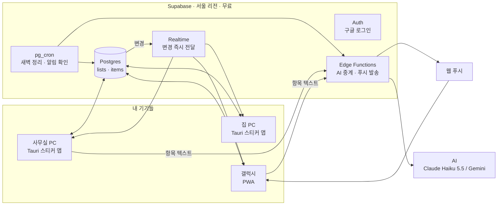
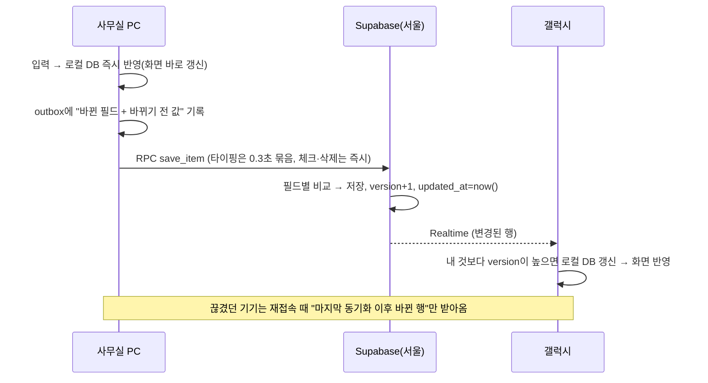

# BK-NOTE 설계 계획서 (v2: 리마인더형)

> 생각났는데 지금 못 하는 일과 아이디어를 **적어 두고 → 짬 날 때 하고 → 지우는** 스티커 노트.
> 듀얼 모니터 오른쪽에 늘 붙어 있고, 갤럭시와 집·사무실 PC가 실시간으로 동기화된다.
>
> 작성일 2026-10-15 · 상태: 설계안 (구현 전)

---

## v1 → v2 바뀐 점

v1은 "의뢰인 정보가 들어가는 업무 노트"를 전제로 설계했다. 실제 용도는 **민감 정보가 거의 없는 리마인더**라서 무거운 부분을 걷어내고 리마인더 기능을 키웠다.

| 항목 | v1 | v2 |
|---|---|---|
| 기본 단위 | 서식 있는 긴 페이지(OneNote 페이지) | **한 줄짜리 항목**(필요하면 아래에 메모). 겉보기는 한 장짜리 노트 |
| 동기화 | Yjs(CRDT) + 자체 프로바이더 + 압축 | **행 단위 동기화**(Supabase 표준 기능). 코드량이 훨씬 적다 |
| 암호화 | 기기 암호화(E2EE), 마스터 비밀번호, 복구 키 | **삭제**. 로그인 + 본인 데이터만 접근(RLS) + 전송 암호화(HTTPS)로 충분 |
| AI 마스킹 | 전화번호·주민번호 자동 가림 | 삭제(민감 정보를 적지 않는 전제) |
| 핵심 흐름 | 쓰기·정리 | **적기 → 미루기 → 하기 → 지우기**, 알림, 묵은 일 관리 |
| AI | 정리·요약·질문 중심 | 빠른 입력 해석, 덩어리 쪼개기, 묵은 일 정리 |
| AI 비용 | 월 $2 안팎 | **월 $0.3 안팎** (이미 충전된 크레딧으로 1년 넘게 감) |

> v1 설계는 git 기록에 남아 있다. 나중에 민감한 내용을 넣고 싶어지면 그때 E2EE를 다시 붙인다.

---

## 0. 한 장 요약

| 항목 | 결정 |
|---|---|
| 형태 | 화면은 웹 기술로 한 번 만든다. PC는 **Tauri 윈도우 앱**(항상 위·오른쪽 도킹·자동 실행·전역 단축키), 폰은 **PWA**(홈 화면 설치). 개발 초반엔 PWA만으로 PC·폰에서 먼저 써 본다 |
| 핵심 흐름 | `Ctrl+Alt+Space` 또는 폰 공유하기로 1초 안에 적기 → ☑ 체크하면 취소선 → **다음 날 새벽 자동 정리**(휴지통 30일) |
| 서식 | 굵게·기울임·밑줄·취소선·형광펜·글자색. **OneNote 단축키 그대로** |
| 동기화 | Supabase 서울 리전, 무료 플랜. 항목 하나가 DB 한 행이다. 오프라인에서 적은 것도 재접속하면 올라간다 |
| 지연 | 내 화면은 즉시. 다른 기기는 **보통 0.3~0.8초**, 폰 데이터 최악 1~2초(추정, P1에서 실측) |
| 알림 | "내일 오전 9시" 같은 시각을 달면 폰·PC로 알림이 간다(무료) |
| AI | 무료 대안 Gemini 무료 티어와 **Claude Haiku 5.5**(추천, 이미 충전된 $4.96으로 충분) 중 선택. 꺼도 앱은 100% 동작한다 |
| 비용 | 서버·배포 **0원**. AI는 월 $0.3 안팎이고 기존 크레딧에서 차감되니 **추가 결제 0원** |

---

## 1. 컨셉: 적고 → 미루고 → 하고 → 지운다

```
 생각남/일 생김 ──▶ [적기] 1초 컷 ──▶ [미뤄두기] 오른쪽 모니터에 늘 보임
                                          │  (선택) 언제·어디서·얼마나 걸리나
                                          ▼
                       짬 남 ──▶ [하기] "지금 15분 있음" 필터
                                          │
                                          ▼
                                 [지우기] ☑ 체크 → 취소선 → 새벽에 자동 정리
```

**하루 장면**
- 통화 중에 해야 할 일이 생김 → `Ctrl+Alt+Space` → "내일 오전 OO 서류 확인" 엔터 → ✅ 할 일 목록에 ⏰ 내일 09:00으로 들어감
- 이동 중 아이디어 → 폰에서 말로 적기 → 💡 아이디어에 들어감
- 오후에 30분 빔 → 오른쪽 패널에서 `⏱️ 30분 이내` + `🏢 사무실` 필터 → 두 개 처리 → ☑ ☑
- 다음 날 아침 → 어제 체크한 건 사라져 있고, 2주 넘게 묵은 항목은 주황색으로 표시돼 있음

---

## 2. 형태: 웹앱이냐, 진짜 앱이냐

| 방식 | 항상 위·자동 실행·전역 단축키 | 폰 | 판단 |
|---|---|---|---|
| 순수 웹앱(브라우저 탭) | ❌ | ✅ | 스티커 느낌이 안 남 |
| Electron | ✅ | ❌ | 상시 메모리 150~300MB라 비추 |
| **Tauri 2 + PWA** | ✅ 가볍고 설치파일 ~10MB | ✅ 같은 코드 | **채택** |

- **공통 코드**(`packages/core`): 화면, 편집기, 로컬 저장, 동기화, AI 클라이언트
- **윈도우**: Tauri로 감싼 스티커 앱
- **갤럭시**: PWA(크롬 → 홈 화면에 추가). 위젯이 꼭 필요해지면 나중에 Capacitor로 감싼다
- **아무 PC**: 같은 PWA 주소로 비상 접속

---

## 3. 기능 설계

### 3.1 화면 구성

```
┌──────────────────────────────┐
│ 📌 ▾  BK-NOTE        🟢  ─ ✕ │  ← 얇은 제목줄 (📌 항상 위, 🟢 동기화 상태)
├──────────────────────────────┤
│ ＋ 적기… (Ctrl+Alt+Space)      │  ← 빠른 입력창
├──────────────────────────────┤
│ 📌 매일  ✅ 할 일 12  ⏳ 대기 3  💡 4 │  ← 섹션 탭
│ [🏢] [🏠] [📱] [⚡5분] [⏱️30분] [⏰오늘] │  ← 필터 칩 (짬 날 때)
├──────────────────────────────┤
│ ☐ OO 서류 확인        ⏰내일 9시 │
│ ☐ **세무사한테 전화**   📱 ⚡    │
│ ☐ 블로그 글감 정리      🏠  14일 │  ← 묵은 일 배지
│ ☑ ~~등기부 떼기~~               │  ← 체크하면 취소선, 새벽에 정리
└──────────────────────────────┘
```

**기본 섹션** (이름·순서·개수 자유롭게 변경)
- 📌 **매일**: 매일 봐야 하는 것. 체크해도 안 지워지고 다음 날 체크가 풀린다(루틴용)
- ✅ **할 일**: 지금 못 해서 미뤄둔 일
- ⏳ **대기**: 상대 회신이나 서류를 기다리는 것
- 💡 **아이디어**

### 3.2 항목 하나

| 속성 | 설명 | 입력 방법 |
|---|---|---|
| 본문 | 한 줄. 굵게·색·형광펜 가능 | 그냥 타이핑 |
| 메모 | 항목 아래 들여쓴 세부 내용(접힘) | `Tab` |
| 색 라벨 | 항목 왼쪽 색 띠 | 우클릭 / 길게 누르기 |
| ⏰ 알림 시각 | 이 시각에 폰·PC 알림 | "내일 3시"라고 쓰면 자동 인식 |
| 상황 태그 | 🏢 사무실 / 🏠 집 / 📱 폰으로 가능 | `@사무실`, `@집`, `@폰` |
| 크기 | ⚡ 5분 / ⏱️ 30분 / 🧱 큰일 | `!5`, `!30`, `!큰` |
| 📌 고정 | 목록 맨 위에 고정 | 클릭 |
| 만든 날 | 자동 기록. 묵은 일 배지에 사용 | 자동 |

전부 선택 사항이다. **아무것도 안 달고 한 줄만 적어도 된다.** 기본은 마찰 0이다.

### 3.3 적기 (최대한 빨리)

| 경로 | 동작 | 단계 |
|---|---|---|
| PC 전역 단축키 `Ctrl+Alt+Space` | 어떤 프로그램을 쓰다가도 작은 입력창이 뜸 → 엔터 → 사라짐 | P2 |
| 오른쪽 패널 빠른 입력창 | 엔터로 연달아 여러 개 | P1 |
| 패널 안에서 엔터 | 노트처럼 다음 줄 = 새 항목 | P1 |
| 폰 「공유 → BK-NOTE」 | 카톡·문자·웹페이지 내용을 그대로 항목으로 | P3 |
| 폰 음성 | 마이크 버튼 → 말하기 → 항목 | P3 |
| 덩어리 붙여넣기 | 여러 줄을 붙이면 "항목 N개로 나눌까요?" 제안 | P1(줄 단위) / P4(AI가 의미 단위로) |

**날짜·태그 자동 인식(규칙 기반, AI 아님)**: "내일", "모레", "다음 주 월", "금요일 3시", "10/20", `@폰`, `!5` 같은 표현을 기기 안에서 바로 해석한다. 무료이고 즉시 처리되며 오프라인에서도 동작한다. 규칙으로 안 풀리는 애매한 문장만 AI에 넘긴다(P4).

### 3.4 하고 지우기

| 동작 | PC | 폰 | 결과 |
|---|---|---|---|
| 완료 | 클릭 ☑ / `Ctrl+Enter` | 탭 ☑ | 취소선 + 흐려짐(바로 안 사라짐 → 실수 방지·뿌듯함) |
| 자동 정리 | — | — | 완료 항목은 **다음 날 새벽 4시**에 휴지통으로(설정: 즉시 / 1시간 뒤 / 다음 날) |
| 바로 지우기 | `Delete` | 왼쪽 스와이프 | 휴지통으로. 5초 동안 「되돌리기」 |
| 휴지통 | 설정 → 휴지통 | 〃 | 30일 보관 후 영구 삭제 |
| 완료 기록 | (선택) 이번 주 처리한 개수 | 〃 | 동기부여용. 내용은 남기지 않고 개수만 |

자동 정리는 **서버가 새벽에 한 번** 처리한다. 그래서 기기가 꺼져 있어도 모든 기기에서 똑같이 정리된다.

### 3.5 묵은 일 관리

리마인더 앱이 망하는 이유는 대개 "쌓이기만 하고 안 지워지는 것"이다. 그래서 다음을 넣는다.
- 만든 지 **7일**이 지나면 회색 배지(「7일」), **14일**이 지나면 주황 배지
- 매주 월요일 아침 「묵은 일 정리」 카드가 맨 위에 뜬다: 2주 넘은 항목마다 [지금 하기] [날짜 정하기] [쪼개기] [지우기] 버튼
- AI를 켜 두면 항목별로 "쪼개면 첫 단계는 이것" 같은 제안을 붙인다(P4)

### 3.6 알림

- ⏰가 달린 항목은 그 시각에 **폰 푸시 + PC 윈도우 알림**이 간다
- 서버가 1분마다 도래한 알림을 확인한다(pg_cron). 폰은 웹 푸시(PWA), PC는 앱이 직접 윈도우 알림을 띄운다. 전부 무료다
- 알림에서 바로 [완료] [1시간 뒤] [내일] 선택(다시 알림)
- 같은 알림이 PC와 폰에 동시에 울리는 게 싫으면 「PC 앞에 있으면 폰 알림 생략」 옵션(PC 앱이 최근 5분 내 사용 중이면 폰 푸시를 생략)

### 3.7 서식과 단축키 (OneNote 손버릇 그대로)

**서식**

| 기능 | 단축키 | 마우스 |
|---|---|---|
| 굵게 / 기울임 / 밑줄 | `Ctrl+B` / `Ctrl+I` / `Ctrl+U` | 글자를 선택하면 뜨는 말풍선 메뉴 |
| 취소선 | `Ctrl+-` (OneNote와 동일) | 〃 |
| 형광펜 | `Ctrl+Alt+H` (OneNote와 동일). 누를 때마다 노랑→초록→분홍→하늘→끄기 | 말풍선의 색 동그라미 |
| 글자색 | `Ctrl+Shift+C` | 〃 |
| 서식 지우기 | `Ctrl+Space` | 〃 |

**항목 다루기**

| 기능 | 단축키 |
|---|---|
| 새 항목 | `Enter` |
| 메모(하위) 넣기 / 빼기 | `Tab` / `Shift+Tab` |
| 완료 | `Ctrl+Enter` (OneNote `Ctrl+1` 도 동일하게 동작) |
| 순서 이동 | `Alt+↑` / `Alt+↓` |
| 다른 섹션으로 보내기 | `Ctrl+Shift+→` 후 섹션 선택 |
| 지우기 | `Delete`(항목 선택 상태) |
| 검색 | `Ctrl+F` |

- 편집기는 TipTap(ProseMirror)이고 인라인 서식만 쓴다. 한 번에 편집기 하나만 띄우는 방식이라(클릭한 항목만 편집 모드) 항목이 수백 개여도 가볍다
- 폰은 키보드 바로 위에 서식 툴바 한 줄(B · I · S · 형광펜 · 색)

### 3.8 스티커 창 (윈도우)

| 기능 | 구현 | 단계 |
|---|---|---|
| 항상 위 / 일반 전환 | Tauri `alwaysOnTop`, 제목줄 📌 | P2 |
| 오른쪽 붙이기 | 버튼을 누르면 **가장 오른쪽 모니터** 오른쪽 끝에 세로 꽉 차게(폭 340~400px) | P2 |
| 위치 기억 | `tauri-plugin-window-state`. 집과 사무실의 모니터 배치가 달라서 기기별로 저장. 모니터가 없으면 자동 보정 | P2 |
| 윈도우 시작 시 자동 실행 / 트레이 | `tauri-plugin-autostart`, 트레이 아이콘 | P2 |
| 전역 단축키 | `Ctrl+Alt+N` 보이기·숨기기, `Ctrl+Alt+Space` 빠른 입력 | P2 |
| 투명도 / 다크 모드 / 글자 크기 | 설정 | P2 |
| 관리자 권한 없이 설치 | 사용자 단위 설치 | P2 |
| 자동 업데이트 | GitHub Releases | P2 |
| 접기 모드 | 오른쪽 끝 얇은 띠로 접힘 → 마우스를 대면 펼침 | P5 |
| 작업표시줄처럼 자리 차지(AppBar) | 다른 창을 최대화해도 BK-NOTE를 피함 | P5 |

### 3.9 갤럭시

| 기능 | PWA | 네이티브(나중에 필요하면) |
|---|---|---|
| 홈 화면 설치·오프라인 | ✅ | ✅ |
| 공유하기로 넣기 | ✅ | ✅ |
| 알림 | ✅ 웹 푸시 | ✅ |
| 음성 입력 | ✅ | ✅ |
| 홈 화면 위젯(할 일 목록) | ❌ | ✅ |
| 실시간 동기화 | 앱이 열려 있는 동안. 다시 열면 1초 안에 따라잡음 | 〃 |

> 안드로이드는 백그라운드 앱의 연결을 끊는다(배터리 정책). 그래서 폰은 "열 때 즉시 따라잡기 + 시간 맞춘 알림은 푸시" 구조다. 리마인더 용도에는 이걸로 충분하다.

### 3.10 AI 기능 (전부 선택, 꺼도 앱은 100% 동작)

| 기능 | 예시 | 언제 |
|---|---|---|
| 빠른 입력 해석(규칙으로 안 풀릴 때만) | "담주 초쯤 OO 건 정리 좀" → ✅ 할 일, ⏰ 다음 주 월 09:00, ⏱️ 30분 | 입력할 때 |
| 덩어리 쪼개기 | 카톡·메모 덩어리 → 할 일 3개로 | 붙여넣을 때 제안 |
| 묵은 일 정리 도우미 | 2주 넘은 항목 → "첫 단계는 ○○" 또는 "지워도 될 듯" | 주 1회 카드 |
| 아이디어 다듬기 | 한 줄 아이디어 → 3~5줄 정리 + 다음 행동 1개 | 버튼 |
| 짬 추천 | "지금 15분, 사무실" → 할 만한 것 3개 순서대로 | 버튼. AI 없이 필터만으로도 기본 동작 |
| 음성 정리 | 말로 한 긴 메모 → 깔끔한 항목 | 폰 |

**원칙**: AI는 몰래 고치지 않는다. 항상 「제안 → 미리보기 → 적용」 순서이고 되돌리기가 된다. 항목 텍스트가 AI 회사로 전송되므로 정말 민감한 내용은 적지 않는다(또는 해당 항목만 🔒 AI 제외).

---

## 4. 시스템 구조



**각 기기 안쪽**

```
[화면·편집기] ⇄ [로컬 DB (IndexedDB)] ⇄ [동기화 모듈: 보낼 목록(outbox) ↔ Supabase]
                  └ 오프라인에서도 읽기·쓰기 전부 가능
```

**폴더 구조(모노레포, pnpm)**

```
bk-note/
├─ packages/core/       # 공통: 화면, 편집기, 로컬 DB, 동기화, 날짜 파서, AI 클라이언트
├─ apps/web/            # PWA (갤럭시 + 비상 접속 + 개발 초반 PC용)
├─ apps/desktop/        # Tauri 2 (창·트레이·단축키·자동 실행·윈도우 알림)
├─ supabase/
│   ├─ migrations/      # 테이블·RLS·트리거·pg_cron
│   └─ functions/       # ai(중계), push(알림 발송)
└─ docs/DESIGN.md
```

---

## 5. 동기화 설계

### 5.1 왜 v1의 CRDT를 뺐나

리마인더 항목은 한 줄짜리라 **같은 항목을 두 기기에서 동시에 고칠 일이 거의 없다**. 그래서 글자 단위 병합(Yjs)은 과하다. 행 단위 동기화로 충분하고, 드물게 생기는 충돌만 안전하게 처리한다.

| | v1 (Yjs CRDT) | v2 (행 단위) |
|---|---|---|
| 코드량 | 자체 프로바이더·압축·스냅샷 | Supabase 기본 기능 + 아웃박스 |
| 서버에서 내용 읽기 | 불가(E2EE) | 가능 → **새벽 자동 정리·알림·AI를 서버에서 처리** |
| 같은 항목 동시 수정 | 글자 단위 병합 | 필드 단위 비교 후 처리(아래 5.3) |

### 5.2 흐름



**규칙**
1. **앱 시작**: 로컬 DB로 화면을 즉시 띄운다 → 서버에서 `updated_at > 마지막 동기화 시각 - 5초` 인 행을 받아 합친다(5초는 시계 오차 여유)
2. **로컬 변경**: 로컬 DB를 먼저 고치고 outbox에 넣는다. 실패하면 outbox에 남겨 두고 재시도한다(앱을 꺼도 남음)
3. **실시간 수신**: Realtime 구독(`items`, 본인 행만). 받은 행의 `version`이 로컬보다 높을 때만 반영한다
4. **포그라운드 복귀·네트워크 복구**: 1번을 다시 실행
5. **삭제**: 실제로 지우지 않고 `deleted_at`만 찍는다(그래야 다른 기기도 지운 걸 안다). 영구 삭제는 서버 크론이 30일 뒤에 한다
6. **순서**: 분수형 정렬 키(`sort_key`)를 써서, 항목 하나를 옮겨도 그 항목 한 줄만 바뀐다
7. **시각**: `updated_at`은 서버 시계로 찍는다(기기 시계가 틀려도 안전)

### 5.3 충돌 처리 (드물지만 안전하게)

기기는 저장할 때 "바꾼 필드의 **바뀌기 전 값**"을 같이 보낸다. 서버는 필드마다 비교한다.
- 서버의 현재 값이 내가 알던 값과 같으면 → 그대로 저장
- 다르면(다른 기기가 그새 고침):
  - **본문**이 양쪽에서 바뀌었으면 → 서버 값을 유지하고, 내 버전은 바로 아래에 **「⚠️ 충돌 사본」 항목**으로 따로 저장한다(아무것도 잃지 않음)
  - 완료·색·태그·알림 같은 단순 필드는 → 나중에 저장한 쪽을 반영

### 5.4 DB 스키마

```sql
create table lists (
  id          uuid primary key default gen_random_uuid(),
  owner       uuid not null default auth.uid() references auth.users,
  name        text not null,                -- '📌 매일', '✅ 할 일', '⏳ 대기', '💡 아이디어'
  kind        text not null default 'normal' check (kind in ('normal','daily')),  -- daily: 체크가 매일 풀림
  sort_key    text not null,
  version     int  not null default 1,
  updated_at  timestamptz not null default now(),
  deleted_at  timestamptz
);

create table items (
  id          uuid primary key default gen_random_uuid(),
  owner       uuid not null default auth.uid() references auth.users,
  list_id     uuid not null references lists,
  parent_id   uuid references items,           -- 메모(하위)
  content     jsonb not null,                  -- TipTap JSON (굵게·색·형광펜 등)
  plain       text  not null,                  -- 검색·AI용 평문
  color       text,
  pinned      boolean not null default false,
  contexts    text[]  not null default '{}',   -- {'office','home','phone'}
  size        text check (size in ('5m','30m','big')),
  remind_at   timestamptz,
  snoozed_until timestamptz,
  done_at     timestamptz,
  deleted_at  timestamptz,                      -- 휴지통
  no_ai       boolean not null default false,  -- 🔒 AI 제외
  sort_key    text not null,
  version     int  not null default 1,
  created_at  timestamptz not null default now(),
  updated_at  timestamptz not null default now(),
  updated_by  text                              -- 기기 id
);
create index on items (owner, updated_at);
create index on items (remind_at) where remind_at is not null and done_at is null and deleted_at is null;

create table push_subscriptions (
  id          uuid primary key default gen_random_uuid(),
  owner       uuid not null default auth.uid() references auth.users,
  device_name text not null,                    -- '갤럭시', '사무실 PC'
  endpoint    jsonb not null,                   -- 웹 푸시 구독 정보
  last_active timestamptz
);

-- 모든 테이블: RLS on, 정책은 owner = auth.uid() 하나
-- 트리거: 저장 시 updated_at = now(), version = version + 1
-- pg_cron:
--   매일 04:00 KST  완료 항목 → 휴지통, 📌 매일 섹션 체크 해제
--   매일 04:10 KST  휴지통 30일 지난 행 영구 삭제
--   매분           remind_at 도래 항목 → Edge Function push 호출
```

---

## 6. 서버

**필요하다.** 집·사무실·폰이 서로 다른 네트워크에 있어서 중간 저장소가 있어야 한다. 직접 관리하는 서버 컴퓨터는 필요 없다.

| 옵션 | 비용 | 판단 |
|---|---|---|
| **Supabase 서울 리전** | 무료 | ✅ 로그인·DB·실시간·크론·서버 함수가 한 곳에 다 있다. 이미 BH SPACE로 써 본 플랫폼이고, 무료 프로젝트 자리가 하나 남아 있다 |
| Firebase(Firestore) | 무료~ | 대안. 서울 리전 있음. 크론·SQL이 아쉬움 |
| Cloudflare Workers + D1 | 무료 | 대안. 로그인·실시간을 직접 붙여야 함 |
| 직접 서버(VM) | 무료~ | 관리 부담 때문에 비추 |
| 서버 없이(P2P, 클라우드 폴더) | 무료 | ❌ 기기가 동시에 켜져 있어야 하거나 충돌·실시간 불가 |

**Supabase 무료 플랜 체크** (공개 자료 기준, 착수할 때 공식 가격표로 재확인)
- 무료 활성 프로젝트 2개 중 `BH-workspace` 1개 사용 중 → **BK-NOTE 자리 있음**. 나중에 BH SPACE 쪽에 프로젝트가 더 필요해지면 유료 전환을 검토해야 한다
- Realtime 동시 연결 200개, 월 메시지 200만 건 → 개인 리마인더는 월 수만 건 수준이라 여유가 크다
- DB 500MB → 텍스트 항목 기준 사실상 무제한
- **7일 동안 활동이 없으면 일시정지** → 매분 도는 알림 크론이 DB를 계속 건드리긴 하지만, 확실히 하려고 GitHub Actions 무료 크론으로 3일마다 핑을 보낸다
- **자동 백업이 약함** → PC 앱이 매일 밤 JSON + 마크다운으로 내보내 원하는 폴더(예: 구글 드라이브 동기화 폴더)에 저장한다

---

## 7. 지연 시간 예상

| 구간 | 예상 | 비고 |
|---|---|---|
| 내 화면 반영 | **즉시** | 로컬 DB 먼저 반영 |
| 날짜·태그 자동 인식(규칙) | **즉시** | 기기 안에서 처리, 오프라인 OK |
| 기기 ↔ 서울 왕복(유선·와이파이) | 5~20ms | |
| 기기 ↔ 서울 왕복(LTE/5G) | 20~60ms | |
| 저장 + Realtime 전달 | 100~400ms | DB 변경 감지 방식 |
| **다른 기기에 뜨기까지(합계)** | **보통 0.3~0.8초 / 폰 데이터 최악 1~2초** | 체감상 "거의 바로" |
| 폰 앱 다시 열 때 따라잡기 | 0.3~1.5초 | |
| 오프라인에서 적은 것 | 연결되는 즉시 업로드 | 손실 없음 |
| 알림 정확도 | 지정 시각 + 0~60초 | 1분 주기 크론 |
| AI 응답(Haiku 5.5) | 1~3초 | 짧은 입력 기준 |

> **추정치**다. P1에서 화면 구석에 「지연 측정」 표시를 넣고 사무실·집·폰 실측값으로 이 표를 갱신한다. 회사 네트워크가 실시간 연결(WebSocket)을 막는지도 이때 확인한다(막히면 5초 주기 확인으로 대체).

---

## 8. 보안 (가볍게)

민감 정보를 적지 않는 리마인더라는 전제로 **기본만 확실히** 한다.
- 로그인: 구글 계정, **본인 계정만 허용**(신규 가입 차단)
- 접근: 모든 테이블 RLS(`owner = auth.uid()`). 다른 계정은 내 행을 못 본다
- 전송: HTTPS / WSS. 저장 데이터는 Supabase 기본 디스크 암호화
- 기기 분실: Supabase에서 세션 전체 로그아웃(설정 화면에 버튼)
- AI: 항목 텍스트가 AI 회사로 전송된다. 정말 민감한 항목은 🔒(AI 제외)를 켜거나 아예 적지 않는다
- 나중에 민감한 내용을 넣고 싶어지면 v1의 E2EE 설계를 다시 붙인다(git 기록 참고)

---

## 9. AI 연결과 크레딧

### 9.1 구조

```
기기 → Supabase Edge Function "ai" → AI 제공자
          ├ API 키는 여기에만 둔다(기기에 키 없음)
          ├ 하루 호출 상한 (예: 200회)
          └ 1순위 실패 시 2순위로 자동 전환, 둘 다 실패하면 "AI 잠시 꺼짐" 표시
```

### 9.2 제공자 (무료부터)

| | 비용 | 장점 | 단점 |
|---|---|---|---|
| **무료 대안: Gemini API 무료 티어** | 0원 | 결제 없이 시작 | 무료 티어 입력은 구글 제품 개선에 쓰일 수 있음(민감 정보가 없으니 감수 가능). 무료 한도와 모델이 자주 바뀌고 갑자기 막힐 수 있음 |
| **추천: Claude Haiku 5.5** | 입력 $0.10 / 출력 $0.50 (100만 토큰당) | 한국어 날짜·문맥 해석이 안정적. API 입력은 기본적으로 학습에 쓰지 않음 | 유료. 단 **이미 충전된 $4.96에서 차감**되니 추가 결제는 없음 |

**리마인더 용도 월 비용(Haiku 5.5)**
- 하루 30회 × (입력 1,500 + 출력 300 토큰) → 월 입력 135만 / 출력 27만 토큰 → **약 $0.27**
- 주 1회 묵은 일 정리(전체 항목 약 1만 토큰) → 월 $0.01 미만
- 규칙 기반 날짜 인식이 대부분을 처리하므로 실제로는 더 적다
- → **$4.96 잔액으로 대략 1년 반**. 자동 충전이 꺼져 있어서 잔액이 0이 되면 AI만 멈추고 과금은 안 늘어난다(앱은 Gemini로 넘어가거나 AI 없이 동작)

> 프로모션 크레딧 $200은 API에 쓸 수 있긴 하지만 **2026-10-21(UTC)에 만료**된다. AI 기능(P4) 완성 전이라 이 계산에서는 제외했다.

**권장 설정**: 1순위 Claude Haiku 5.5(기존 크레딧) → 2순위 Gemini 무료 티어 → 둘 다 안 되면 AI 없이.

### 9.3 기능별 호출

| 기능 | 출력 형태 |
|---|---|
| 빠른 입력 해석 | 구조화 출력(JSON: 섹션·본문·알림 시각·상황·크기) |
| 덩어리 쪼개기 | 항목 배열 → 미리보기 → 선택해서 추가 |
| 묵은 일 정리 | 항목별 제안(지금 하기 / 날짜 / 쪼개기 / 지우기) |
| 아이디어 다듬기 | 짧은 텍스트(스트리밍) |
| 짬 추천 | 항목 id 순서 목록 |

---

## 10. 비용 정리

| 항목 | 비용 |
|---|---|
| 서버(Supabase 서울, 무료 플랜) | ₩0 |
| 윈도우 앱 빌드·배포(GitHub Actions + Releases) | ₩0 (코드서명 없이. 처음 설치할 때 SmartScreen 경고 1회) |
| 갤럭시(PWA) | ₩0 |
| 웹 비상 접속 호스팅(Cloudflare Pages 또는 Vercel) | ₩0 |
| 알림(웹 푸시) | ₩0 |
| AI | Gemini 무료 ₩0 / Claude Haiku 5.5 월 $0.3 안팎(기존 $4.96 크레딧에서 차감) |
| **새로 결제할 돈** | **₩0** |

---

## 11. 기술 스택

| 영역 | 선택 |
|---|---|
| 언어 | TypeScript (+ 데스크톱 네이티브 부분만 Rust) |
| UI | React + Vite |
| 편집기 | TipTap (인라인 서식만: Bold, Italic, Underline, Strike, Highlight(multicolor), TextStyle+Color) |
| 로컬 DB | IndexedDB (Dexie) |
| 동기화 | 자체 모듈(outbox + Supabase RPC + Realtime 구독) |
| 날짜 인식 | 한국어 규칙 파서(자체, 테스트 케이스 위주로) |
| 정렬 | fractional-indexing |
| 데스크톱 | Tauri 2 + window-state, autostart, global-shortcut, notification, single-instance, updater 플러그인 + 트레이 |
| 모바일 | PWA (Web Share Target, Web Push) |
| 백엔드 | Supabase 서울: Auth, Postgres, Realtime, pg_cron, Edge Functions |
| AI | Claude Haiku 5.5 / Gemini (Edge Function 중계, 제공자 스위치) |
| 테스트 | Vitest(동기화·충돌·날짜 파서), Playwright(화면) |
| 배포 | GitHub Actions(윈도우 러너) → GitHub Releases, Cloudflare Pages(PWA) |

> 이 클라우드 작업 환경은 리눅스라 윈도우 설치 파일은 GitHub Actions의 윈도우 러너에서 만든다(비공개 저장소 무료 월 2,000분, 윈도우는 2배 차감. 빌드 1회 약 10분이라 충분).

---

## 12. 개발 로드맵

| 단계 | 내용 | 완료 기준 | Claude Code 권장 |
|---|---|---|---|
| **P0 뼈대** | 모노레포, React+Vite, 항목 목록 UI, TipTap 인라인 서식, 로컬 DB | 브라우저에서 적기·서식·체크·지우기 동작 | Sonnet 5.5·medium |
| **P1 동기화 + PWA로 바로 쓰기** | Supabase 프로젝트(서울), 구글 로그인, 스키마·RLS·트리거, outbox·Realtime·충돌 사본, 새벽 자동 정리 크론, PWA 설치, 지연 측정 표시 | PC 브라우저와 폰을 동시에 열면 1초 안에 반영. 비행기 모드에서 적고 복귀하면 올라감. **이 시점부터 실사용 시작** | Opus 5.5·high (동기화 코어만 xhigh) |
| **P2 윈도우 스티커** | Tauri 래핑, 항상 위·오른쪽 붙이기·위치 기억·자동 실행·트레이·전역 단축키·빠른 입력 팝업, 자동 업데이트, 매일 밤 로컬 백업 | 사무실·집 PC 둘 다 OneNote 대신 쓰기 | Opus 5.5·high |
| **P3 리마인더 기능** | 날짜·태그 규칙 파서, 알림(크론 + 웹 푸시 + 윈도우 알림 + 다시 알림), 상황·크기 필터, 묵은 일 배지·주간 정리 카드, 폰 공유하기·음성 | "내일 9시" 적으면 다음 날 9시에 폰·PC 알림 | Opus 5.5·high |
| **P4 AI** | Edge Function 중계·상한, Claude/Gemini 스위치·폴백, 빠른 입력 해석·쪼개기·묵은 일 정리·다듬기·짬 추천 | "담주 초쯤 OO 건 정리" → 알림·크기가 달린 항목으로 | Opus 5.5·high |
| **P5 다듬기** | 접기 모드, AppBar 도킹, 완료 기록, 안드로이드 위젯(필요 시 네이티브), 다크 모드 손질 | 쓰면서 나온 불편 목록 소진 | Sonnet 5.5·medium (어려운 건 Opus 5.5·high) |

- 동기화 버그 원인을 도저히 못 찾을 때만 **Fable 5.1**
- P1이 끝나면 바로 실사용이 가능하다(PC는 브라우저 창으로). 스티커 느낌은 P2에서 완성된다

**착수 전에 준비할 것**
1. Supabase에 BK-NOTE 프로젝트 생성 승인(무료 두 번째 자리, 서울 리전)
2. 구글 로그인용 OAuth 설정(콘솔에서 몇 번 클릭, 안내해 줌)
3. AI 키: Anthropic 콘솔 API 키(기존 크레딧 사용) 및/또는 Gemini 무료 키 → Supabase Edge Function 비밀값으로만 저장
4. 사무실 PC에 프로그램 설치가 가능한지

---

## 13. 리스크와 대응

| 리스크 | 대응 |
|---|---|
| Supabase 무료 플랜 일시정지 | 크론 활동 + 3일 주기 핑 + 매일 밤 로컬 백업 |
| 동기화 꼬임 | 서버 시각·version 기준, 충돌 시 사본 보존, 소프트 삭제, 시나리오 테스트(오프라인·동시 수정·순서 뒤바뀜) |
| 회사망이 실시간 연결 차단 | P1에서 실측. 막히면 5초 주기 확인으로 대체 |
| 집·사무실 모니터 배치가 다름 | 기기별 위치 저장 + 「오른쪽 붙이기」 자동 보정 |
| 항목이 쌓이기만 함 | 묵은 일 배지 + 주간 정리 카드 + 자동 정리 |
| AI 크레딧 소진 | Gemini 폴백 → 그래도 안 되면 AI 없이 동작. 자동 충전 꺼져 있어서 과금 폭주 없음 |
| 특정 서비스 종속 | JSON·마크다운 내보내기 + 표준 Postgres |

---

## 14. 정해야 할 것

| # | 질문 | 결정 |
|---|---|---|
| 1 | 완료 처리 | ✅ **확정(2026-10-15): 체크 → 다음 날 새벽 4시 자동 정리**(휴지통 30일). 설정에서 즉시/1시간 뒤로 바꿀 수 있음 |
| 2 | 기본 섹션: 📌 매일 / ✅ 할 일 / ⏳ 대기 / 💡 아이디어 | 이대로 시작해서 써 보며 조정 |
| 3 | AI 1순위: Claude Haiku 5.5(기존 크레딧) vs Gemini 무료 | 추천: Haiku 1순위 + Gemini 폴백 (P4 전에 확정) |
| 4 | 사무실 PC 설치 가능 여부 | ✅ **확정(2026-10-15): 설치 가능** |

---

## 15. 참고 (착수 시 공식 문서로 재확인)

- Supabase Realtime 한도: <https://supabase.com/docs/guides/realtime/limits>
- Supabase 요금(무료 플랜 한도, 서드파티 정리): <https://designrevision.com/blog/supabase-pricing.md>
- Tauri window-state 플러그인: <https://v2.tauri.app/plugin/window-state/>
- Tauri 릴리스 목록: <https://v2.tauri.app/release/tauri/all-versions/>
- Gemini 무료/유료 티어 데이터 사용 조건(약관 인용): <https://simonwillison.net/2024/Oct/17/gemini-terms-of-service>
- Gemini 가격 정리(서드파티): <https://www.morphllm.com/gemini-api-pricing>
- Claude 모델 가격: Anthropic 공식 가격표(2026-10 기준 Haiku 5.5 $0.10/$0.50, Sonnet 5.5 $2/$10 per 1M tokens)
